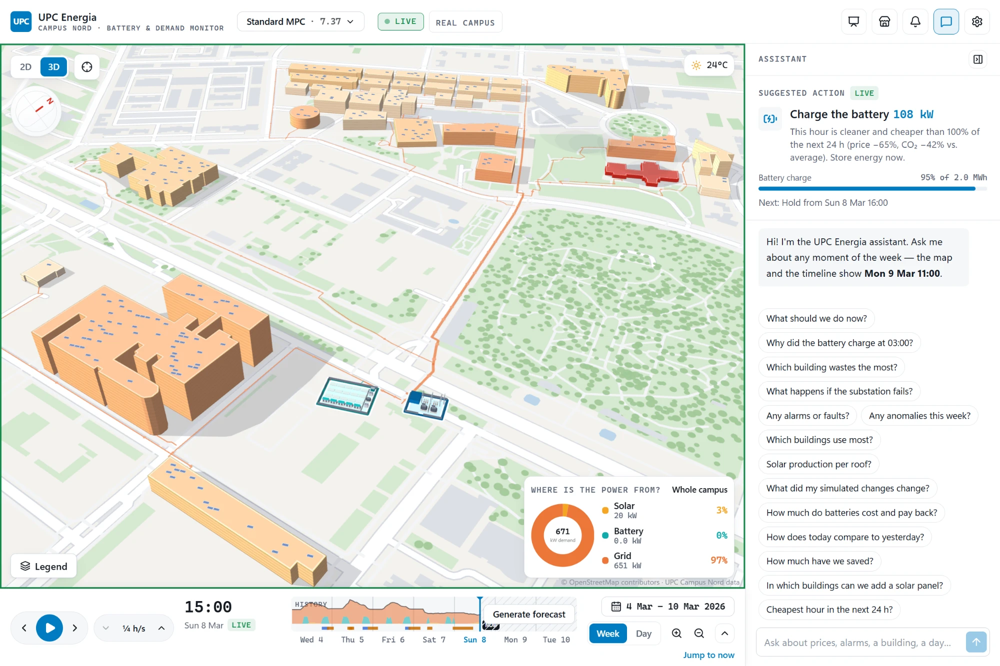
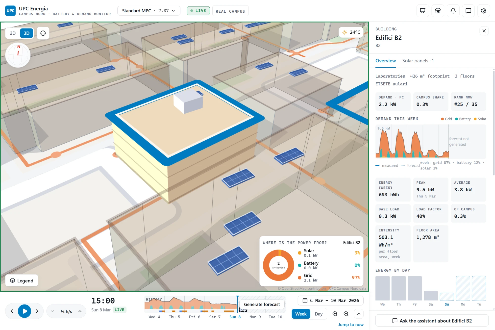
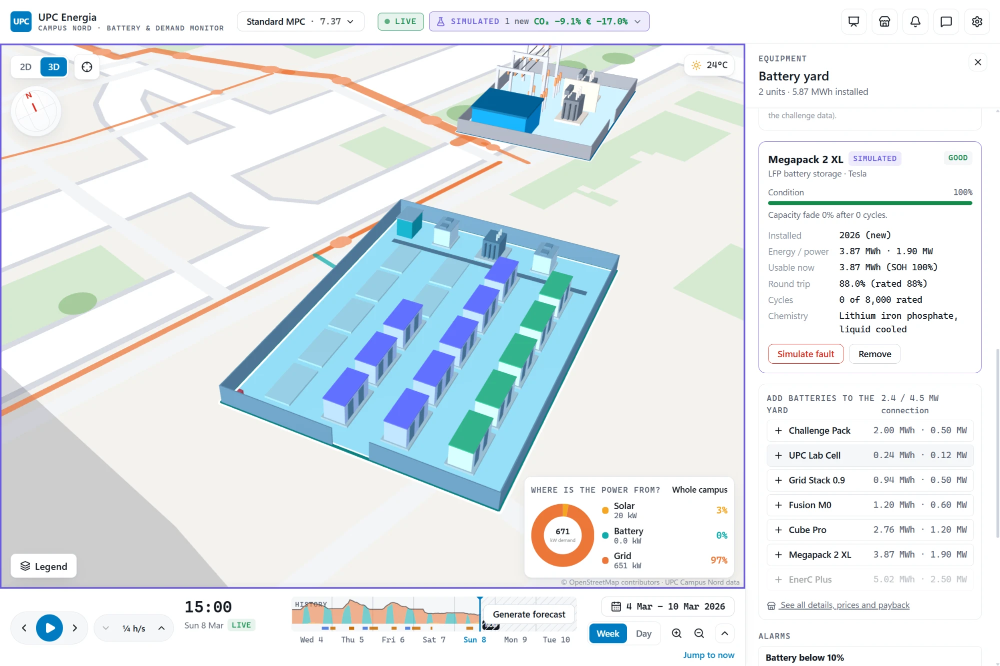
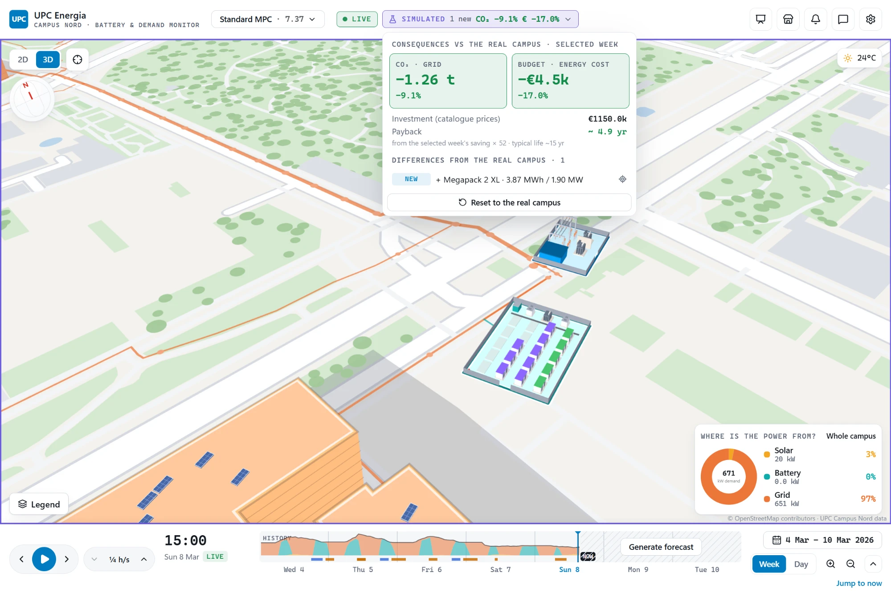
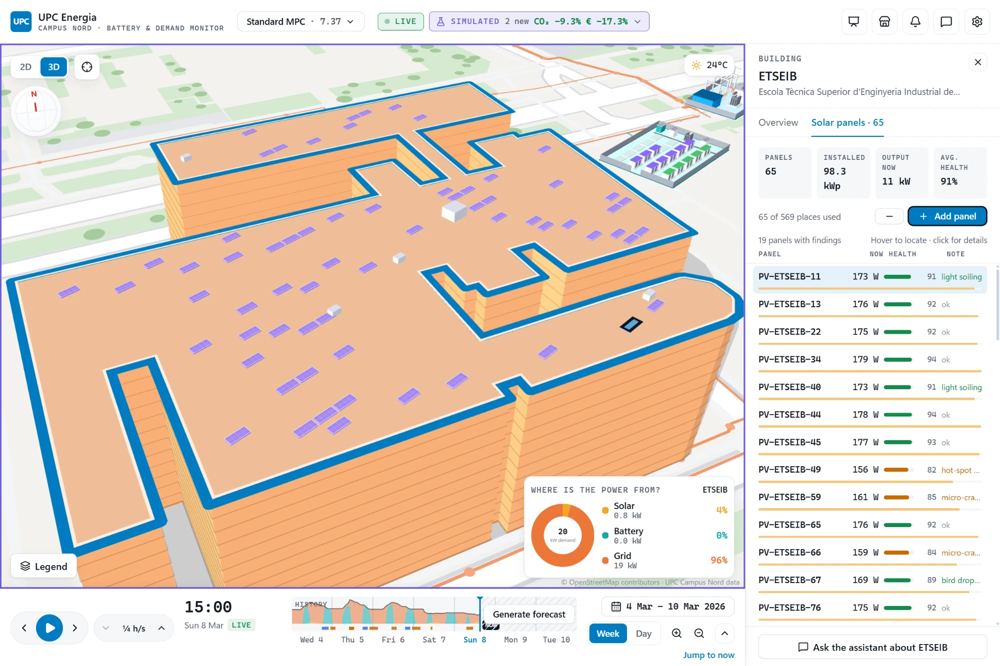
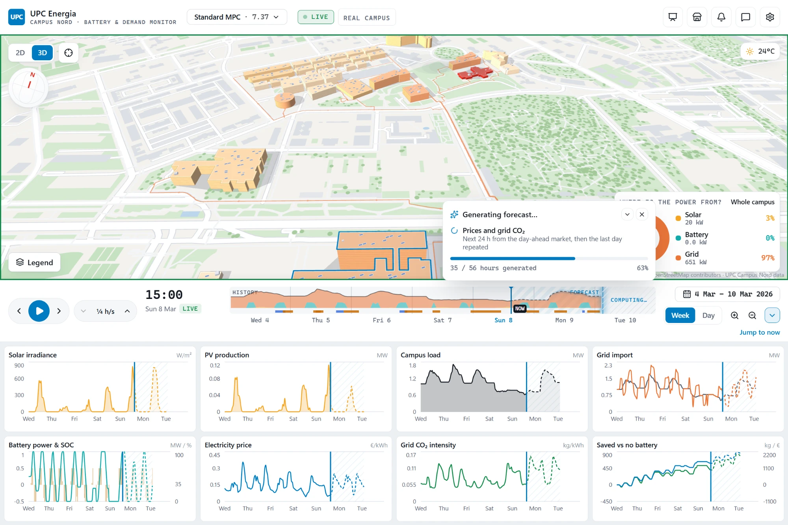
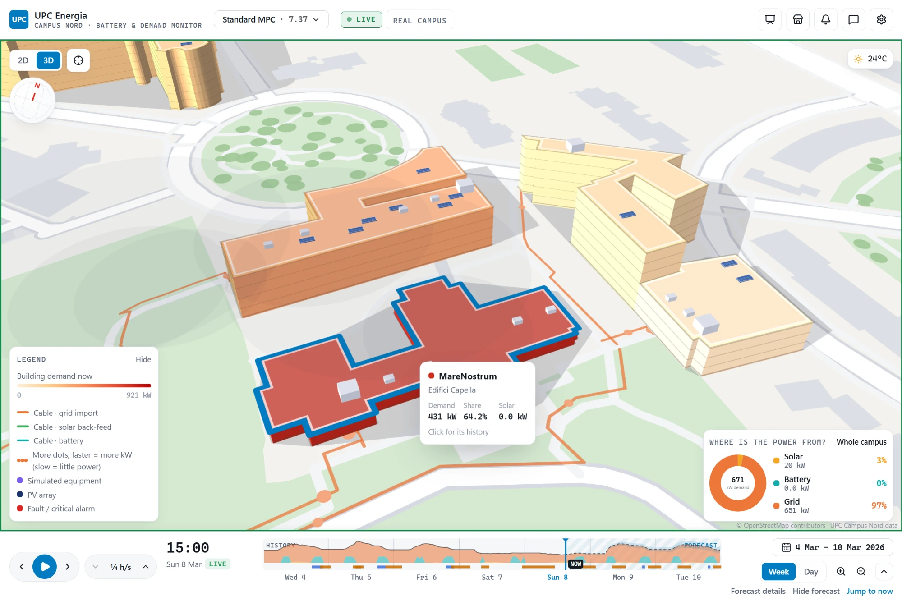
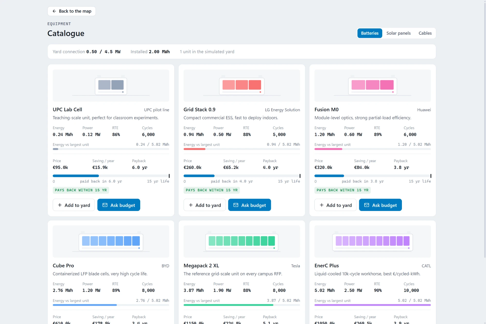

# Datathon FME 2026 — UPC Sostenible Battery Challenge

> An agent that charges and discharges the 2 MWh battery of UPC Campus Nord every hour to cut **CO₂ (70 %)** and **electricity cost (30 %)** — plus an interactive 3D digital twin of the campus that shows the agent at work.

Team **Natan · Aiman · Sami** · Challenge: <https://repteupc.datathon.cat/>

| | |
|---|---|
| **Standard mode** | Exact 24 h look-ahead optimiser, numpy only. **5.667** on the train year = 99.85 % of the perfect-foresight bound, 0 infractions. Leaderboard **6.43**. |
| **Hard Mode** | Stochastic 24 h MPC with profile + LightGBM forecasts of price, CO₂, load and solar (only 3 h of price/CO₂ are published). Hold-out 20.5 vs bound 22.4; best public score **23.84** (0 infractions). |
| **Demo (UPC Energia)** | Game-style 3D digital twin of the campus replaying 35 real weeks through a TypeScript port of the simulator and agent. |

## How it works

The score is `max(0, 0.70·ΔCO₂ % + 0.30·ΔCost % − penalty·infractions)` against the same campus with no battery. On this campus net load (demand − solar) is almost always above the battery's 500 kW, so the battery never causes export and the score is **linear in the setpoint**: the task reduces to energy arbitrage on one blended signal `w_t = 0.7·CO₂_t/CO₂_base + 0.3·price_t/Cost_base`. Buy when `w` is low, sell when it is high, lose 10 % per round trip.

- **Standard agent** (`agent/agent.py`) solves the 24 h problem exactly with a backward recursion on the marginal value of stored energy — no solver, no ML model, 1–6 ms per decision. A final clamp guarantees the battery limits are never violated.
- **Hard Mode agent** (`agent_hard/`) has to forecast prices, CO₂, load and solar. It plans over net-load scenarios and uses forecasts from profile + ridge models with LightGBM residual boosters.

Full write-up, evidence, what was tried and dropped, and risks: [`docs/SOLUTION.md`](docs/SOLUTION.md) and [`docs/HARD_MODE_HANDOFF.md`](docs/HARD_MODE_HANDOFF.md).

## Quick start

Requires Python 3.11+ (and Node 20+ for the demo).

```bash
git clone https://github.com/NatanSisoev/Datathon-FME && cd Datathon-FME
python -m venv .venv && source .venv/Scripts/activate   # PowerShell: .venv\Scripts\Activate.ps1; mac/linux: source .venv/bin/activate
pip install -r requirements.txt
python scripts/fetch_kit.py        # downloads the official data kit (13 MB zip) into git-ignored data/, starter_kit/, docs/official/
pytest -q
python -m sim.evaluate --weeks     # score the agent on the 35 real train weeks
```

Check a submission before uploading:

```bash
python -m sim.check agent/agent.py --zip                  # AST scan, clamp at extreme SOC, timing; builds submission.zip
python -m sim.check --hard --zip                          # same for the Hard Mode agent
python starter_kit/check_submission.py submission.zip     # official smoke test
```

## Repository layout

```
agent/            Standard-mode agent (exact 24 h MPC) — the submittable file
agent_hard/       Hard Mode agent + forecasting models (model.json, LightGBM boosters)
sim/              Local simulator, metric, evaluator, submission checker (validated against the official environment.py)
experiments/      Oracle LP bound, MPC benchmarks, Hard Mode diagnostics, neural-forecaster trials
demo/frontend/    3D digital twin (Vite + React + deck.gl) — see its README
notebooks/        Exploration and EDA
tests/            pytest suite (incl. parity with the official environment)
docs/             SOLUTION, HARD_MODE_*, HANDOFF, QUESTIONS
scripts/          fetch_kit.py
SUBMISSIONS.md    Log of every leaderboard submission
```

## Demo — UPC Energia

UPC Energia is an interactive twin of Campus Nord: OSM-based buildings, buried cable network with real power flows, day/night from the sun position, solar roofs, and the agent's explanation of every decision. Switch weeks, models, battery size or solar capacity and watch the real agent and score react.

```bash
cd demo/frontend
npm install
npm run dev          # http://localhost:5173
npm run validate     # proves the TS engine matches the Python results on all 35 weeks
```

Details: [`demo/frontend/README.md`](demo/frontend/README.md).

### Screenshots

| | |
|---|---|
|  |  |
| **Live 3D campus map** | **Building detail** |
|  |  |
| **Battery yard** | **Simulated impact vs the real campus** |
|  |  |
| **Solar panels per roof** | **Forecast and charts** |
|  |  |
| **Demand heat map** | **Equipment catalogue** |

## Challenge rules in short

- Battery 2,000 kWh, ±500 kW, 90 % round trip, no export revenue. Infractions are penalised — every `act()` goes through a safe clamp, and we report `violations=0` everywhere.
- Submitted code may import only numpy, pandas, scipy, scikit-learn, joblib, xgboost, lightgbm and a few stdlib modules (enforced by an AST scan mirrored in `sim/check.py`). Limits: 60 s per simulation, 25 MB zip.
- Overfitting is guarded by whole-week cross-validation; hidden test weeks are the last 7 days of each month, and no hidden data is ever used.

Full spec: [`CHALLENGE.md`](CHALLENGE.md). Team workflow: [`WORKFLOW.md`](WORKFLOW.md). Agent/contributor entry point: [`CLAUDE.md`](CLAUDE.md).

## License

See [`LICENSE`](LICENSE).
